<div align="center">


# Aurfy Signal Studio

**Turn a signal into a conversation.**

A human-in-the-loop go-to-market studio for B2B payments teams: watch a live stream of merchant signals, separate evidence from inference, shape an illustrative co-brand concept, and leave with a reviewed outreach note and one concrete next action.

*Built for the Converge.AI hackathon.*

[](https://react.dev)
[](https://www.typescriptlang.org)
[](https://vitejs.dev)
[](https://supabase.com/docs/guides/functions)
[](#installable-and-offline-friendly)
[](https://enter.pro)

[**Live demo**](https://d14079b4625f4011bd68f5b82bd7bf6a.prod.enter.pro/) · [Screenshots](#screenshots) · [The problem](#the-problem) · [How it works](#how-it-works) · [Architecture](#architecture) · [Run it locally](#run-it-locally)

<br/>

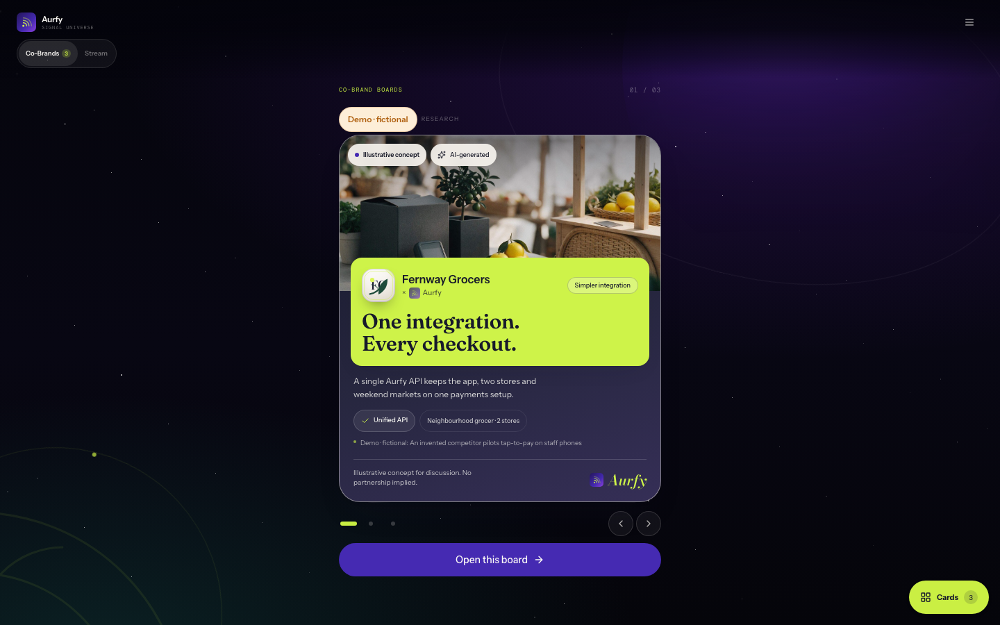

</div>

---

## Screenshots

### Find the signal, imagine the co-brand

| Signal stream | One tap: signal → co-brand card |
|---|---|
| 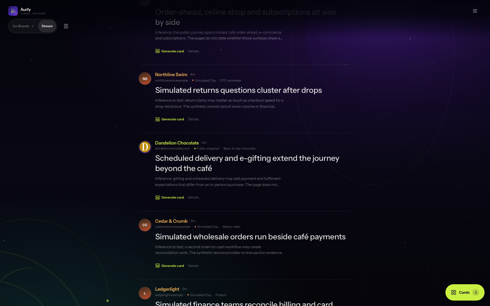 | 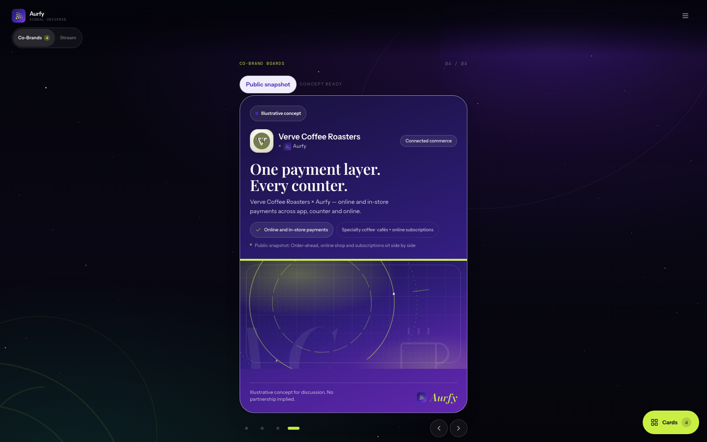 |
| Every signal shows where it came from: public snapshot, simulated Clay, fictional demo. | "Generate card" builds the headline, angle, capability, type and artwork, then removes the signal from the stream. |

| Prospect engine | Co-brand deck |
|---|---|
| 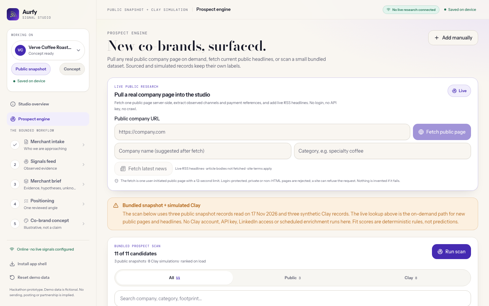 | 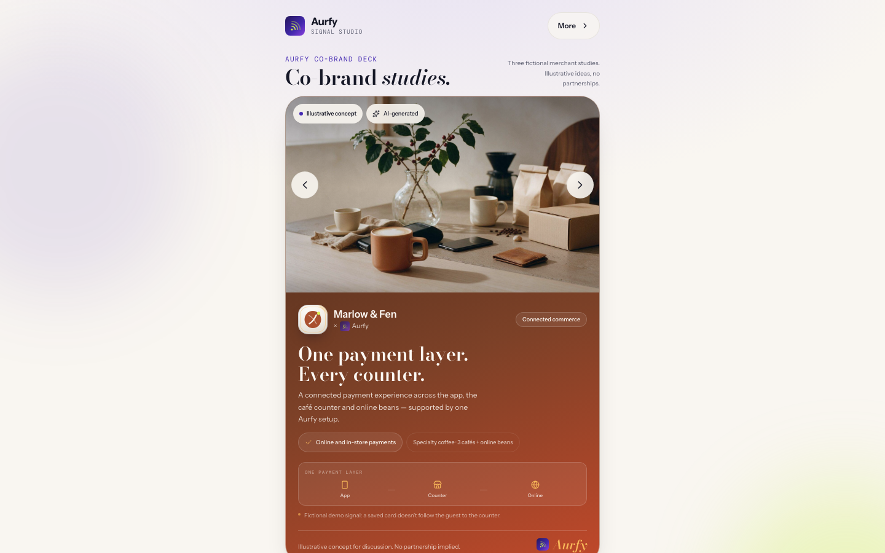 |
| Pull any public company page or recent headlines into the studio, or scan the bundled prospect set. | `/deck` presents finished concepts as a swipeable showcase. |

### The seven-step studio

| Signals: evidence with its limits attached | Positioning: one angle, approved words only |
|---|---|
| 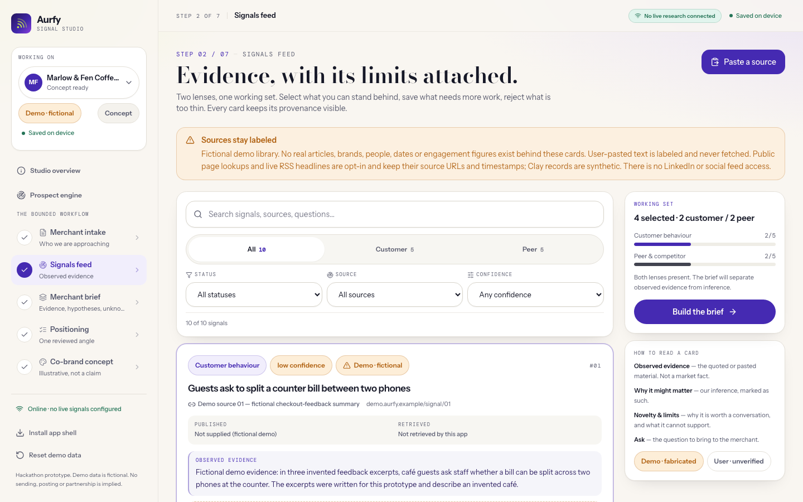 | 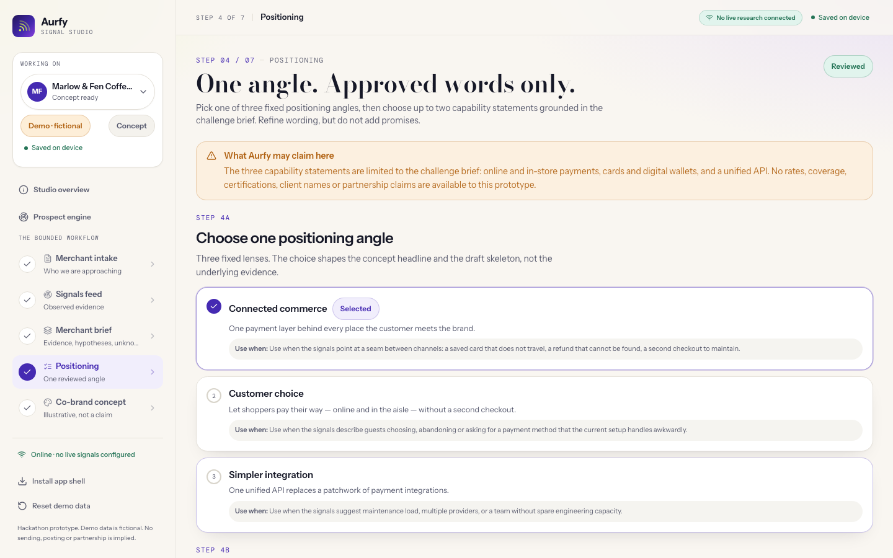 |
| **Brief: separate what you saw from what you think** | **Concept: an illustrative idea, clearly framed** |
| 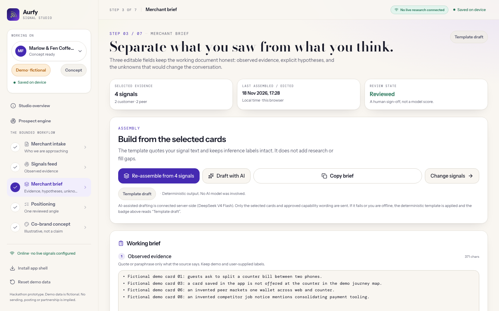 | 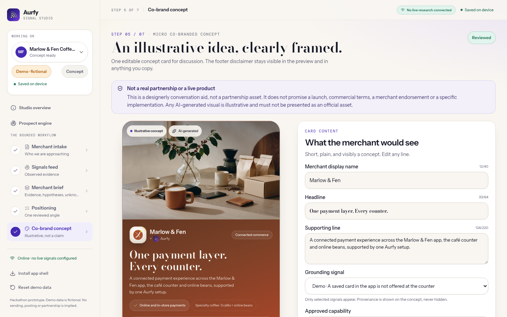 |
| **Outreach: a short note, copied by a human** | **Pipeline: every stage is a human decision** |
| 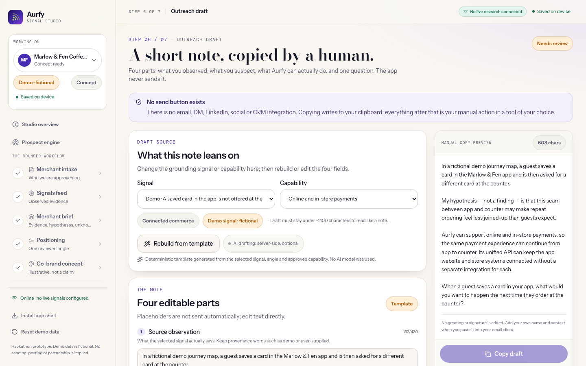 | 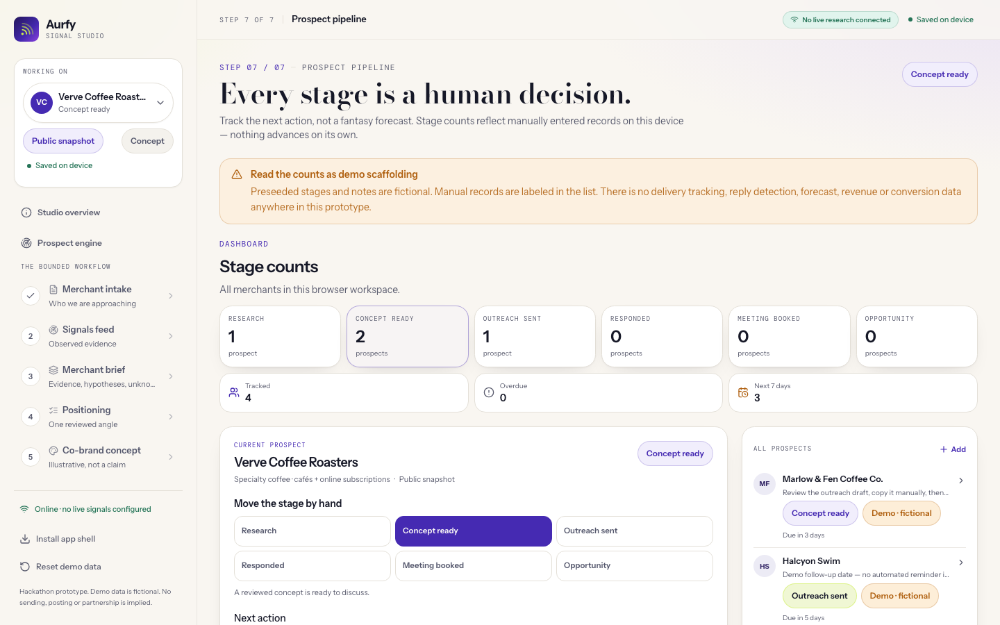 |

### Built for the phone

<p align="center">
  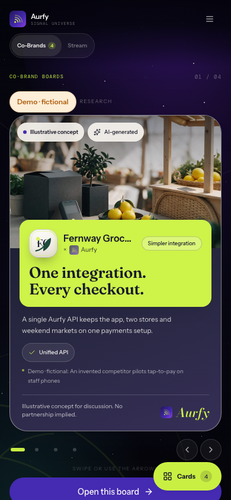
  &nbsp;
  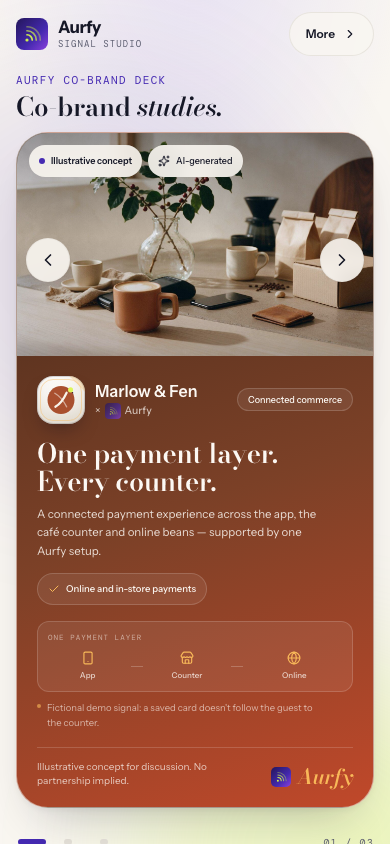
  &nbsp;
  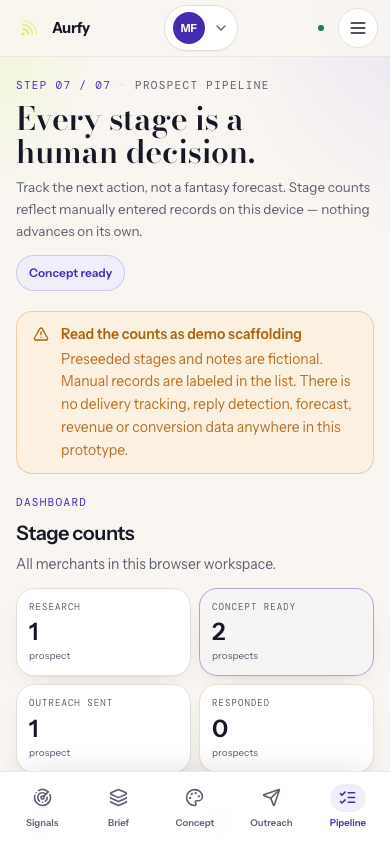
</p>

---

## The problem

Small B2B sales teams, and payments companies in particular, have the same weekly ritual. Someone spots something about a merchant: a new app, a second checkout, a wholesale launch, a customer complaining about gift cards. Then it falls apart:

- **The signal gets lost.** It lives in a Slack thread or a tab that never gets reopened.
- **Evidence and guesswork blur together.** "They're struggling with payments" turns out to be one Reddit comment.
- **Outreach is generic or overclaims.** AI writers will happily invent metrics, partnerships and urgency the evidence doesn't support.
- **There's no next step.** Research ends with a doc, not a date on the calendar.

Current AI tooling makes the last two worse: it generates confident, fluent, unsourced copy at scale and nudges teams toward auto-send.

## The idea

**Aurfy Signal Studio** is a bounded, repeatable workflow that takes one observed signal to one reviewed, sendable note and one scheduled sales action, **and is honest at every step about what is known**.

Every signal carries its **provenance** (fictional demo, user-pasted, public page snapshot, live news headline, or simulated Clay enrichment), its **evidence**, the team's **inference** stated as an inference, its **limitations**, a **confidence level**, and an **open question** for the merchant. AI is optional and constrained: it may only rephrase what's in the evidence, and a deterministic template does the same job when AI is off, offline or failing.

> Nothing is ever sent automatically. The human copies the note, the human sends it, the human moves the deal.

---

## Highlights

| | |
|---|---|
| **Live signal universe** | The homepage is an auto-scrolling stream of merchant signals with **Stream** and **Boards** views, filters by source and category, and one-tap **Queue a co-brand**. |
| **Live research** | Paste a merchant URL and an edge function fetches that one public page, then extracts its title, channels (pickup, delivery, subscriptions, gift cards, wholesale…), payment terms (Apple Pay, Klarna, tap to pay…) and logo. A news lookup pulls recent headlines from public RSS. Both become signals labelled with their provenance. |
| **Prospect engine** | A sourced prospect list that mixes real public-page snapshots with clearly labelled *simulated* Clay enrichment (headcount, tech stack, intent topics, contact role). |
| **Evidence-first brief** | Three separate boxes: **Observed**, **Hypotheses**, **Unknowns**. Drafted by AI or a template, and every brief needs a human review tick. |
| **Positioning** | Pick one of three angles (*Connected commerce*, *Customer choice*, *Simpler integration*) and only the capability statements you've approved. No invented rates, clients or certifications. |
| **Co-brand concept studio** | An illustrative merchant × Aurfy concept card with 5 layouts, 4 editorial typefaces, 4 palettes, an uploaded logo, and optional **AI-generated artwork** (Seedream 5). A **send-safe** toggle strips logos and generated imagery before sharing. |
| **Grounded outreach** | A four-part note (observation → hypothesis → capability → question). The hypothesis must literally begin *"My hypothesis (not a finding):"*. |
| **Pipeline** | Six stages from *Research* to *Opportunity*, each with a next action, due date and stage history. |
| **Concept deck** | `/deck` is a curated showcase of finished concepts, ready to present. |
| **Installable PWA** | Works as a phone app with an offline app shell and a mobile bottom nav. Your workspace persists locally. |

---

## How it works

The studio guides one merchant through seven steps. Each step has a review gate, and progress is tracked per merchant.

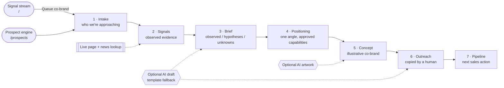

| Step | Route | What the human does | What the system guarantees |
|---|---|---|---|
| 1. Intake | `/intake` | Add or pick a merchant | Records where the merchant came from (demo / manual / public / simulated) |
| 2. Signals | `/signals` | Select, save or reject signals; paste new ones; run a live lookup | Every signal keeps its provenance, date and limitations |
| 3. Brief | `/brief` | Review and edit a three-part brief | Observation and inference are never in the same box |
| 4. Positioning | `/positioning` | Choose one angle and approve capabilities | Only pre-approved capability statements can be used |
| 5. Concept | `/concept` | Art-direct a co-brand concept | Marked illustrative; send-safe mode removes merchant marks |
| 6. Outreach | `/outreach` | Edit and copy a short note | The hypothesis is labelled; there is no send button |
| 7. Pipeline | `/pipeline` | Set stage, next action, due date | Stage history is kept for every move |

### Demo data

The workspace is seeded with three **fictional** merchants, *Marlow & Fen Coffee Co.*, *Halcyon Swim* and *Fernway Grocers*, each with a full set of signals, a concept and artwork, so judges can click through the whole flow in a minute. The prospect engine and feed also include public-page snapshots of real independent brands. Those are labelled *"Public snapshot; not independently audited. No partnership implied."*

---

## Responsible AI by design

The trust story is the product, not a disclaimer at the bottom. Concretely:

1. **Provenance on every record.** `Signal.provenance` is one of `demo | user | public | news | clay`. The label is carried into prompts, cards, toasts and the brief itself.
2. **Inference is typed as inference.** `evidence` and `whyItMatters` are separate fields. The UI and the prompt never merge them.
3. **A hard-ruled system prompt.** The drafting function ([`supabase/functions/aurfy-draft`](supabase/functions/aurfy-draft/index.ts)) tells the model to use only supplied JSON. It may not invent articles, dates, metrics, quotes or partnerships, must never upgrade demo, simulated or headline-only signals to "verified", and may only state Aurfy's three approved capabilities. Output must be strict JSON.
4. **Deterministic fallback.** [`src/aurfy/draft.ts`](src/aurfy/draft.ts) builds the same brief and outreach from templates. If AI is offline, slow or returns unparsable output, the workflow keeps going and tells you which path was used (`generation: "template" | "ai" | "manual"`).
5. **Human review gates.** Briefs, positioning, concepts and outreach each have a `reviewed` flag that the user sets.
6. **No auto-send, no scraping at scale.** The live page fetch reads **one** public page per request, identifies itself with an honest User-Agent, caps the HTML at 350 KB, and blocks `localhost`, `.local`, `.internal` and private hosts (SSRF guard). News comes from public RSS headlines only, and article bodies are never fetched or presented as reporting.
7. **Generated art is never a logo.** AI imagery is "illustrative artwork, never a logo or official asset", and send-safe mode removes it entirely.

---

## Architecture

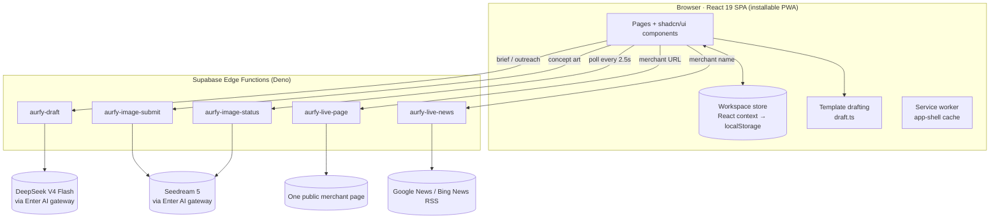

**Key design decisions**

- **Local-first state.** The whole workspace (merchants, signals, briefs, positioning, concepts, outreach, pipeline) is a single typed `WorkspaceState` held in React context and persisted to `localStorage` under `aurfy.signal.studio.v1`. There's no login wall for judges, nothing private leaves the device unless you ask for an AI draft, and a reset re-seeds the demo.
- **Thin, single-purpose edge functions.** Each function does one network job, keeps API keys server-side, and returns a structured `{ ok, reason }` error so the UI can always explain a failure and fall back.
- **Async image generation.** Artwork is submit-then-poll (`aurfy-image-submit` → `aurfy-image-status`), with progress shown in the concept editor so slow generations never block the page.
- **Mobile-first.** A dedicated bottom nav, safe-area insets, `viewport-fit=cover`, and an install prompt hook (`use-install-prompt.ts`).

### Tech stack

| Layer | Choice |
|---|---|
| UI | React 19, TypeScript 5.9, React Router 7 |
| Styling | Tailwind CSS, shadcn/ui (Radix primitives), Framer Motion, lucide icons |
| Typography | Bodoni Moda, Playfair Display, Fraunces, DM Serif Display (concepts) · Instrument Sans + DM Mono (UI) |
| Data | Typed local store (`src/aurfy/store.tsx`), TanStack Query, Zod |
| Backend | Supabase Edge Functions (Deno) |
| AI | DeepSeek V4 Flash (text drafting), Seedream 5 (concept artwork), via the Enter AI gateway |
| Build | Vite 7, pnpm, ESLint 9 |
| Platform | PWA (manifest + service worker), Enter.pro hosting and analytics |

---

## Project structure

```
src/
├── aurfy/                    # Domain logic: no UI
│   ├── types.ts              # Signal, Merchant, Brief, Concept, Outreach, Pipeline types
│   ├── store.tsx             # Workspace context, persistence, actions
│   ├── demo.ts               # Fictional demo merchants + signals
│   ├── prospects.ts          # Public snapshots + simulated Clay prospects
│   ├── feed.ts               # Builds the homepage signal stream, suggests an angle
│   ├── content.ts            # Angles, approved capabilities, stages, palettes, fonts
│   ├── draft.ts              # Deterministic template drafting (always available)
│   ├── ai.ts                 # Client for the aurfy-draft function
│   ├── live-research.ts      # Client for live page + news lookups
│   ├── use-concept-visual.ts # Submit/poll hook for AI artwork
│   ├── showcase.ts           # Curated deck examples
│   └── progress.ts           # Per-merchant step completion
├── pages/                    # One file per route (see table above)
│   ├── SignalFeed.tsx        # "/"       live stream + boards
│   ├── Showcase.tsx          # "/deck"   concept deck
│   ├── Studio.tsx            # "/more"   workflow overview
│   ├── Prospects.tsx         # "/prospects"
│   └── Intake · Signals · Brief · Positioning · Concept · Outreach · Pipeline
├── components/aurfy/         # App shell, concept card, signal card, board gallery,
│                             # live lookup, news panel, merchant switcher…
└── components/ui/            # shadcn/ui primitives
supabase/functions/
├── aurfy-draft/              # Grounded brief/outreach drafting (strict-JSON LLM call)
├── aurfy-image-submit/       # Start an artwork generation task
├── aurfy-image-status/       # Poll an artwork task
├── aurfy-live-page/          # Fetch + parse one public merchant page
└── aurfy-live-news/          # Recent headlines from public RSS
public/
├── manifest.webmanifest, sw.js, icons/   # PWA
└── examples/, logos/                     # Fictional demo artwork and marks
```

---

## Run it locally

**Prerequisites:** Node 20+ and pnpm.

```bash
git clone <this-repo>
cd aurfybrand
pnpm install
cp .env.example .env      # analytics vars are optional
pnpm dev                  # http://localhost:5173
```

The full seven-step workflow, the demo merchants, the template drafting and the concept studio all work **with no backend at all**. AI drafting, AI artwork and live lookups call the Supabase edge functions in `supabase/functions/`. Deploy those to your own project (`supabase functions deploy <name>`) and set the `AI_API_TOKEN_*` secret they read for the Enter AI gateway.

| Script | Purpose |
|---|---|
| `pnpm dev` | Start the Vite dev server |
| `pnpm build:prod` | Production build |
| `pnpm preview` | Serve the production build |
| `pnpm check` | ESLint + TypeScript type-check |

---

## A 60-second judge walkthrough

1. **Open `/`.** Watch the signal stream, switch to **Boards**, and filter by source. Note the provenance chip on every card.
2. **Queue a co-brand** on any signal. You land in the studio for that merchant.
3. **Signals:** select two signals. Optionally paste a real merchant URL into *Live lookup* and see a public-page signal appear with its retrieval timestamp.
4. **Brief:** hit *Draft with AI*, then compare it with the template draft. See how hypotheses and unknowns stay separate.
5. **Positioning → Concept:** pick an angle, then art-direct the concept by switching layout, typeface and palette and generating artwork. Toggle **send-safe**.
6. **Outreach:** read the four-part note and copy it. There is deliberately no send button.
7. **Pipeline:** move the merchant to *Outreach sent* and set a next action and due date.
8. **Open `/deck`** for the finished concept showcase.

---

## What's next

- Real enrichment connectors (Clay, CRM) in place of the simulated records, keeping the same provenance model
- Team workspaces with shared review and approval
- Signal scoring that learns from which signals led to replies and meetings
- Export of concept cards and briefs to PDF and slides

---

## Honest limitations

- This is a **hackathon prototype**. Demo merchants and their signals are fictional, and Clay records are simulated.
- Public-page snapshots and news headlines are **observed, not audited**. Featuring a brand does not imply any relationship with it.
- The workspace lives in your browser's `localStorage`. Clearing site data resets it.
- Aurfy capability statements are intentionally limited to three generic claims.

<div align="center">

Built with care for the **Converge.AI hackathon** · Scaffolded and hosted on [Enter.pro](https://enter.pro)

</div>
